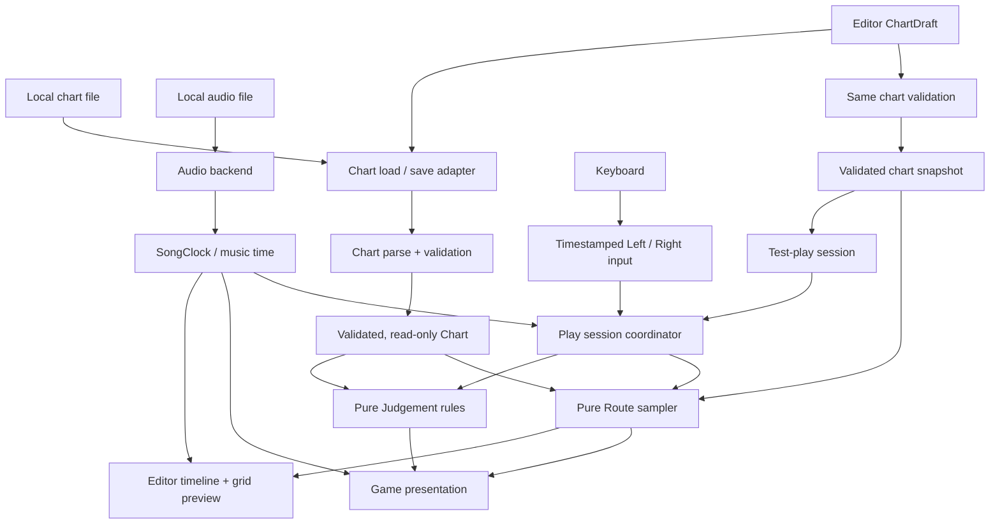

# LOCUS — Architectural Boundaries

**Task:** A-01 — Define module ownership  
**Status:** Proposed architecture contract (pending Stage 1 human gate)  
**Scope:** MVP v0.1, Windows  
**Design reference:** [GDD](../GDD.md)  
**Execution plan:** [Roadmap](../ROADMAP.md)

> This document specifies **who owns which responsibilities and which dependencies are allowed**. It does not select a graphics library, freeze the chart schema or timing values, or create an implementation framework. Those decisions belong to A-02 through A-09.

## 1. Non-negotiable principles

1. **The chart decides the route.** Player input affects judgements, not the marker's authoritative position or heading.
2. **Audio-related musical time decides the moment.** Render frame count, frame delta, and animation position never determine timing or input grades.
3. **There is only one route algorithm.** Play mode, editor preview, and test-play must share the same deterministic route sampler.
4. **The MVP grid is 4×4 with Wrap only.** Crossing an edge preserves heading and consumes one quarter-note step; seam visuals must not imply a line crossing the grid interior.
5. **Core logic runs headlessly.** Chart validation, beat/time math, route sampling, and judgement logic can be tested without a window, audio device, or local filesystem.
6. **Dependencies flow inward.** Platform, game UI, and editor may use core rules; core rules must not import their callers.
7. **Start small.** Responsibility boundaries do not require a plugin system, ECS, service locator, dynamic injection framework, or a class for each concept.

## 2. Data-flow overview

The diagram shows **runtime data flow**, not compile-time import direction. Solid arrows represent values/events passed to consumers. A single game session coordinates the components; the diagram intentionally does not require a separate executable process for each box.



**Important qualification:** The editor owns the mutable draft, while the renderer receives already computed snapshots and display parameters. In code, the session coordinator may call Route/Clock/Judgement and pass simple value objects to the UI; the UI is not required to call Route directly just because the diagram shows route data arriving there.

## 3. Ownership table

| Responsibility | Owner | Input / output | Does **not** own |
| --- | --- | --- | --- |
| Chart domain | **Chart** (pure core) | Parsed, validated chart data; format validation and deterministic serialization rules | Audio playback, file dialogs, movement animation, judgement |
| Filesystem/chart I/O | **Platform storage adapter** | Local chart path ↔ chart bytes; chart-relative audio path resolution | Chart semantics or UI decisions |
| Beat/time math | **Timing** (pure core) | BPM + offset + song time ↔ beat position | Reading wall-clock time, device management, rendering |
| Audio playback and clock | **MusicClock/Audio** (platform adapter + small interface) | Audio load/play/pause/seek; coherent timestamped song position | Chart rules, moving the marker, judging turn direction |
| Keyboard input capture | **Input adapter** (platform) | Fresh key-down edges with timestamps and Left/Right actions | Scoring, auto-turns, renderer states |
| Logical movement | **Route** (pure core) | Chart + requested beat → heading, grid segment, progress, Wrap seam information | User input, mutable score, drawing, audio-device calls |
| Input evaluation | **Judgement** (pure core) | Expected chart events + timestamped actions + configured windows → per-event grade and result state | Authoritative route, graphics, low-level keyboard polling |
| App/game session | **App** (orchestrator) | Chart + audio/clock + inputs + core outputs → lifecycle state and presentation snapshot | Duplicated turn math, duplicated judgement math, editor-only chart rules |
| Game presentation | **Game UI** (view) | Read-only state → 4×4 grid, marker, future trajectory, HUD, results | Music clock authority, chart modifications, grading decisions |
| Chart authoring | **Editor** (feature/controller) | Mutable ChartDraft + edit commands; validation; preview/test-play requests | A second route engine, a second timing convention, direct judgement in the timeline |
| Editor presentation | **Editor UI** (view) | Draft/editor state → timeline widgets and synchronized grid preview | Chart parsing rules, authoritative marker positions |

The core can be a handful of cohesive source files. These owners are **logical responsibilities**, not a mandate for eleven build targets or classes.

## 4. Allowed compile-time dependency direction

The arrows below mean "may import or call," not "must import or call."

```text
                        App / session orchestration
                  /         |         |          \
            Game UI     Editor UI   Editor      Platform adapters
                 \          |         |          /
                  \         |         |         /
                     Pure core contracts
                   /       |         |       \
                Chart    Timing     Route    Judgement
```

### Allowed

- **Chart** may use plain value types and a small chosen serialization library; it must remain graphics/audio independent.
- **Timing** may use chart timing metadata/value types and standard numeric operations.
- **Route** may use **Chart** and **Timing** values; it returns immutable route samples/segments and seam indicators.
- **Judgement** may use chart event types, Timing conversions, timestamped input **values**, and a window configuration.
- **Platform adapters** may use narrow core value types or interfaces, but contain the actual OS/audio/keyboard/filesystem API calls.
- **App/session** may compose Chart, Timing, Route, Judgement, and the platform adapters, and provide snapshots/actions to UI.
- **Game UI** may consume read-only core presentation values and use the chosen rendering library; it sends user commands to App rather than directly mutating the Chart.
- **Editor feature/controller** may use Chart, Timing, Route, and App-provided clock/storage services. It owns ChartDraft and can request a validated, immutable play snapshot.
- **Editor UI** may use shared rendering widgets, editor controller actions, and read-only preview data. It does not implement its own movement rules.
- **Tests** may call pure core directly; integration tests may additionally invoke App and adapters.

### Forbidden

- **Core → App, UI, Editor, Platform** imports, callbacks, or graphical/audio device access.
- **Route → keyboard, judgement, score, window, or audio backend** dependencies.
- **Judgement → Route mutations, renderer frame time, screen coordinates, or audio playback commands**.
- **Game UI or Editor UI → assigning grades, advancing the music clock, or deciding authoritative grid coordinates**.
- **Editor → a private duplicate of the movement, Wrap, beat-to-time, or judgement implementation**.
- **Input adapter → changing the chart route**.
- **Platform storage → silently rewriting chart event rules during load/save**.
- **Any module → implicitly assuming that crossing from (3, y) to (0, y) should be drawn as an interior diagonal/straight segment**.

If a feature seems to require one of these dependencies, move the rule to the correct owner or have App pass explicit data rather than creating a circular import.

## 5. Important boundary contracts

These are conceptual contracts. Names and exact signatures are **not** frozen in A-01.

### 5.1 Chart → Route

- Input: a **validated chart** and an arbitrary nonnegative musical beat position.
- Output: deterministic logical cell/heading, interpolation segment/progress, and whether the step crosses a Wrap seam.
- Invariant: identical chart and beat position always return identical route data, regardless of player actions, FPS, or previous seeks.

**MVP rule:** movement has four headings, one quarter-note grid step per beat, with Wrap across all four edges. Turn-at-node ordering is still to be finalized in A-02.

### 5.2 Clock → App → Route/Presentation

- Audio/Clock produces a coherent song-time snapshot; Timing converts it to a chart beat using BPM and offset.
- App obtains that snapshot **once per logical update** and uses it consistently for route sampling, scheduled events, and presentation.
- UI may interpolate already computed progress visually but cannot invent a separate authoritative music time.

The precise alignment strategy, offset sign, and monotonic-to-audio timestamp correspondence are to be defined and tested in A-02 and A-07.

### 5.3 Input → App → Judgement

- Input produces discrete Left/Right **key-down** events with timestamps, not a current key-is-held direction.
- App maps timestamps onto the same song-time domain used by scheduled chart events.
- Judgement determines Perfect/Good/Bad/Miss and exposes a one-result-per-event outcome.
- App displays feedback and aggregates results; it **never redirects Route** due to a Miss.

Numerical timing thresholds, simultaneous-press handling, and the exact arbitration policy belong to A-03 and later timing tasks.

### 5.4 Editor → Chart snapshot → Play

- Editor owns mutable **ChartDraft**, which may temporarily be invalid while a user edits values.
- Before preview requiring reliable route data or before test-play, validate the relevant draft and construct a read-only Chart snapshot.
- Route preview calls the **same Route owner** used during Play, with the editor's playhead/clock position.
- Test-play starts an ordinary App play session from that validated snapshot and returns to the draft afterward.
- Loading and saving use the same parser/serializer contract as gameplay chart loading.

The editor may have a separate **interaction state** (selection, drag operation, zoom, undo stack), but not a separate musical time model or route algorithm.

## 6. Lifecycle ownership

| Operation | Coordinator action | Core behavior | UI behavior |
| --- | --- | --- | --- |
| Start play | App validates Chart, opens local audio, initializes play session | Route and Judgement start from chart-defined initial state | Show count-in / play view |
| Advance song | App reads SongClock and input events | Route samples current position; Judgement resolves due events | Render snapshot and latest grade |
| Wrong or missing input | App forwards input or window expiration to Judgement | Chart route unchanged; result records Miss | Show Miss without changing marker's path |
| Pause/resume | App commands audio lifecycle and freezes/resumes session | No fake beat progression or premature Miss | Show/close pause overlay |
| Editor scrub | Editor sets preview time via authorized clock/seek interface | Route samples requested time; no gameplay judgement awarded | Move playhead and preview consistently |
| Save edit | Editor validates and requests storage write | Chart serialization represents same draft values | Show success/error and clear dirty flag only on success |

Precise pause/seek judgement semantics will be recorded in A-02/A-03; this table gives **ownership**, not the final timing algorithm.

## 7. Suggested source ownership (not a mandatory layout)

```text
src/
  core/       # chart model/validation; beat math; route; judgement
  platform/   # audio and clock bridge; keyboard capture; file I/O
  app/        # play session, state transitions, editor controller
  ui/         # game view, editor view, small shared controls
tests/        # pure logic fixtures first; integration tests second
mvp/
  GDD.md
  ROADMAP.md
  architecture/
    BOUNDARIES.md
```

Do not create empty directories or placeholder abstractions simply to match this diagram. Final build targets, source filenames, and third-party UI/rendering libraries are decisions for A-09 and the Foundation stage.

## 8. Validation checklist for future tasks

- [ ] Pure Chart/Timing/Route/Judgement tests can run without a display or audio device.
- [ ] Miss/incorrect input cannot modify route state, including after replay or seek.
- [ ] Both Game and Editor preview call the exact same route and Wrap logic.
- [ ] No grade changes when the render frame rate or render load changes for identical input timestamps.
- [ ] Wrap seam data stays explicit until presentation, where exit/re-entry pieces are drawn separately.
- [ ] Chart file errors are surfaced without crashing or silently changing values.
- [ ] No module brings in a heavyweight dependency unless a measured requirement justifies it.

This checklist states architecture expectations; it is **not evidence** that the tests or features already exist.

## 9. Deferred decisions

| Roadmap task | Decision still required |
| --- | --- |
| A-02 | Beat-zero convention, offset sign, turn/step boundary ordering, song-end rule |
| A-03 | Key-down arbitration, overlap/stray presses, pause/seek judgement rules |
| A-04 | Visual details of Wrap exit/re-entry |
| A-05 | Exact versioned JSON chart schema |
| A-07/A-08 | Real audio-clock stability and packaging observations |
| A-09 | Production stack, UI library approach, pinned dependencies |

**A-01 completion condition:** This document defines Chart, MusicClock/Audio, Route, Judgement, App UI, and Editor ownership, includes a data-flow diagram, records allowed/forbidden dependency directions, and explicitly forbids renderer-driven timing and editor-specific route logic.
